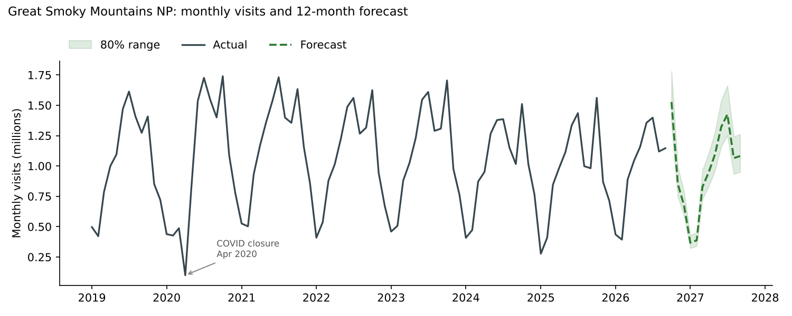
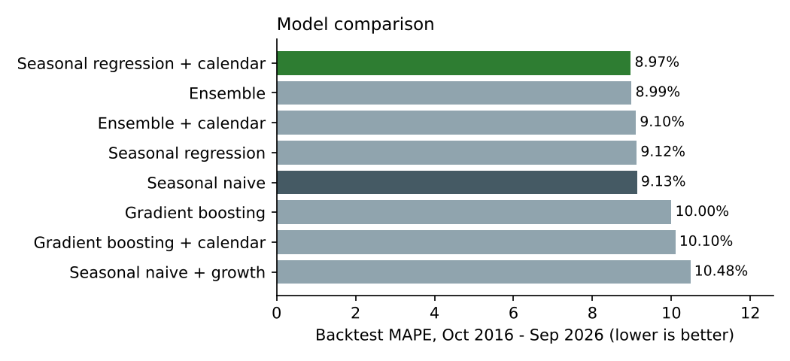
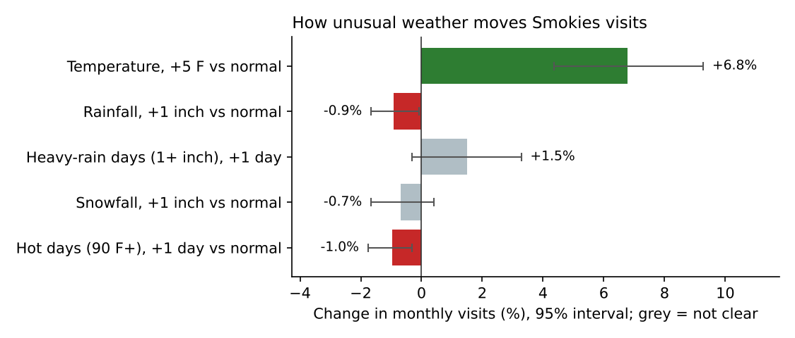

# Smokies Visitation Forecast

Forecasting monthly visits to **Great Smoky Mountains National Park**, the most visited national park in the US, using 47+ years of National Park Service data, 47 years of local weather, and a dated record of park disruptions. Gateway businesses in Gatlinburg, Pigeon Forge and Cherokee plan staffing and inventory around these numbers.



## Results

- **Next 12 months (Oct 2026 – Sep 2027): about 11.6 million visits** from the best-scoring model. All eight models land between **11.6 and 12.1 million**, compared with 12.1 million in the last 12 months.
- October 2026 is forecast as the busiest month, at about 1.53 million visits (80% range 1.34–1.78 million).
- The best model (seasonal regression with calendar features) has an **8.97% average monthly error** in a 10-year walk-forward backtest.



| Model | MAPE, all years | MAPE, last 24 months | Annual total error |
|---|---|---|---|
| **Seasonal regression + calendar** | **8.97%** | 10.83% | 6.48% |
| Ensemble (regression + gradient boosting) | 8.99% | **10.11%** | 6.47% |
| Ensemble + calendar | 9.10% | 10.54% | 6.34% |
| Seasonal regression | 9.12% | 10.71% | 6.66% |
| Seasonal naive (same month last year) | 9.13% | 10.71% | **5.81%** |
| Gradient boosting | 10.00% | 10.64% | 6.83% |
| Gradient boosting + calendar | 10.10% | 10.64% | 6.69% |
| Seasonal naive + growth | 10.48% | 11.77% | 6.55% |

### What the weather and event data showed



- **Warmth brings people.** A month 5 °F warmer than normal for its time of year sees about **6.8% more visits** (95% interval 4.4% to 9.3%). Six of the seven biggest upside surprises in the backtest were at least 1.7 °F warmer than normal, and the biggest downside miss (Jan 2025, 33% below forecast) was 4.5 °F colder than normal. Oct–Nov 2020 also reflect the post-COVID surge in outdoor travel.
- **Rain and extreme heat keep people away.** Each extra inch of rain cuts visits about 0.9%, and each extra 90 °F+ day about 1.0%. Snow and heavy-rain-day counts showed no clear effect.
- **Weather can't fix the forecast.** Next year's weather is unknown when a 12-month forecast is made, so it can't be a forecast input. Even with *perfect* knowledge of each month's actual weather, backtest error would only fall from 8.97% to 8.48%, and that gain isn't statistically clear (95% interval −0.15 to +1.10 points).
- **Calendar effects are tiny.** Easter timing, weekend-day counts and the March 2023 parking-tag policy are known in advance, so they *can* be used. Adding them improved MAPE by 0.15 points (95% interval −0.24 to +0.52), which is not distinguishable from zero.

### The honest finding

The best model beats the simple "same month last year" baseline by only 0.17 points of MAPE (95% interval −0.62 to +0.96), and the baseline is still best at predicting **annual totals**. The top five models sit within 0.16 points of each other, and even the gap between the best model and the baseline is within the noise of 10 years of backtests. Seasonality explains most of the variation. Weather explains a real but modest slice, and much of what's left (events, road closures, regional tourism trends) isn't in the data. That's why the app shows every model's forecast range rather than one confident number.

## Data

| Dataset | Source | Coverage | Checks |
|---|---|---|---|
| Monthly recreation visits | [NPS Visitor Use Statistics](https://irma.nps.gov/Stats/), *Recreation Visitors By Month*, park GRSM | Jan 1979 – Sep 2026 (2026 preliminary) | Every year's 12 months sum to the official annual total (48/48) |
| Daily weather → monthly | [Open-Meteo historical archive](https://open-meteo.com/), averaged for Gatlinburg, TN and Cherokee, NC | Jan 1979 – Sep 2026 | Complete months only; column totals checked against the source |
| Disruptions | Dated news and NPS releases (below) | 8 months flagged | Each date checked against a source |
| Calendar | Computed (Easter, weekend days) + parking-tag policy | Any month, past or future | Easter algorithm checked against known dates |

**Disruptions flagged** (cleaned out of model inputs and excluded from scoring, but kept in the charts):

| Event | Months | Source |
|---|---|---|
| Federal shutdown closed the park Oct 1–15, 2013 | Oct 2013 | [TN Governor's office](https://www.tn.gov/former-governor-haslam/news/2013/10/15/haslam-announces-agreement-to-open-great-smoky-mountains.html) |
| Chimney Tops 2 fire reached Gatlinburg Nov 28, 2016 | Nov–Dec 2016 | [Wikipedia](https://en.wikipedia.org/wiki/2016_Great_Smoky_Mountains_wildfires) |
| COVID-19 closure Mar 24 – May 9, 2020 | Mar–May 2020 | [WBIR](https://wbir.com/article/entertainment/places/news/great-smoky-mountains-to-reopen-in-phases/51-00d55816-8acd-4a2a-917a-86f12d29531d) |
| Hurricane Helene closures from Sep 26–27, 2024 | Sep–Oct 2024 | [NPS](https://www.nps.gov/grsm/learn/news/newfound-gap-road-us-441-visitor-centers-and-other-park-areas-close-in-preparation-for-tropical-storm-impacts.htm) |
| Park It Forward parking tags from Mar 1, 2023 (a forecast feature, not a disruption) | Mar 2023 onward | [NPS](https://home.nps.gov/grsm/learn/news/park-announces-2023-fee-program-changes.htm) |

## Approach

1. **Walk-forward backtest.** Each model is refit at the start of every year (Oct 2016 – Oct 2025) and forecasts the next 12 months, the way it would be used in practice. That gives 10 out-of-sample years and 113 scored months.
2. **No leakage.** Forecast inputs are only things known at forecast time: visit lags of 12+ months and calendar features. Weather enters only the separate explanatory analysis.
3. **Models:** seasonal naive, seasonal naive with growth, ridge regression on log visits with month effects, scikit-learn `HistGradientBoostingRegressor`, ensembles, and calendar-aware versions of each.
4. **Weather as anomalies.** Each month's weather is measured against its 1991–2020 normal, so "July is hot" isn't confused with "this July was unusually hot." Effect intervals come from resampling whole years (block bootstrap).
5. **Honest comparisons.** Paired bootstrap intervals test whether one model's edge over another is real.
6. **Uncertainty:** the 80% forecast range comes from the best model's actual backtest errors.

## Interactive app

The Streamlit app has four tabs: the forecast with its uncertainty range, a model comparison with backtests, weather and events (effect sizes, biggest misses, event sources), and seasonality patterns.

## Run it locally

```powershell
# from this folder, using the portfolio virtual environment
..\.venv\Scripts\Activate.ps1
pip install -r requirements.txt       # already installed in the portfolio venv
python src\prepare_data.py            # visits + weather + calendar + events -> data\processed\grsm_monthly.csv
python src\train.py                   # backtest, pick best model, 12-month forecast
python src\weather_effects.py         # weather effect sizes and biggest misses
python src\make_figures.py            # README charts
streamlit run app.py                  # open the app
```

To refresh: re-export the NPS report table into `data/raw/grsm_monthly_raw.txt`, update `data/raw/weather_monthly.csv` from the Open-Meteo archive (same columns), add any new disruptions to `src/events.py`, then rerun the steps above.

## Project structure

```
data/raw/               NPS visits table, monthly weather
data/processed/         modeling table, backtest, metrics, forecast, weather effects
src/events.py           calendar features and dated disruption events (with sources)
src/prepare_data.py     merge + validate + flag
src/models.py           models and walk-forward backtest
src/train.py            backtest, model selection, significance tests, forecast
src/weather_effects.py  weather anomalies, effect sizes, perfect-weather upper bound
src/make_figures.py     static charts
app.py                  Streamlit app
reports/                figures and JSON summaries
```

## Next steps

- **Short-range forecasts with weather forecasts:** a 1–2 week daily model using NWS forecasts, where weather *is* knowable.
- **Regional demand signals:** Pigeon Forge and Gatlinburg lodging tax collections and airport (TYS) passenger counts.
- **Daily data:** NPS traffic counters for staffing-level forecasts.

---
Data: National Park Service, Visitor Use Statistics; Open-Meteo historical weather archive. Analysis by Jim.
